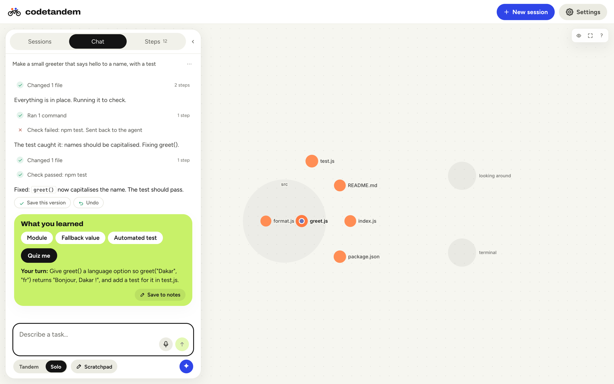
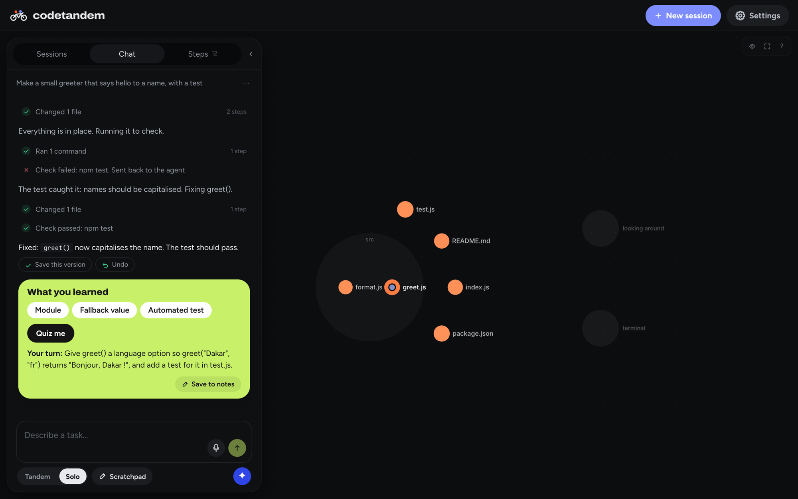

# Codetandem

*You steer. It pedals.* Formerly called agent-stage; the repository, the data folder `~/.agent-stage` and the npm
package still use the old name.

[](https://github.com/Djbrl/agent-stage/actions/workflows/ci.yml)
[](https://github.com/Djbrl/agent-stage/releases/latest)
[](LICENSE)
[](#models)
[](https://nodejs.org)

**The coding-agent harness for learners.** For people who already write some code and use AI agents, but want to
stay in the loop and actually learn. You watch the agent move across a map of your project, **Learn mode** (the default)
makes it stop for your call before it writes code, every step is labelled in plain words, and you can ask "why",
replay and undo. It runs on **open-weight models** (Qwen3-Coder on our own GPU, or Ollama on your own computer for
offline or classroom use with no API bill) or on **Claude**.

> Open Source × AI Hackathon 2026 (Galsen Dev): track **Éducation & apprentissage**.

**En bref.** De plus en plus de développeurs et d'étudiants livrent du code écrit par une IA qu'ils ne savent ni lire,
ni expliquer, ni corriger : l'IA fait le travail et ils n'apprennent rien. Codetandem garde l'humain dans la boucle.
L'agent se déplace sur une carte de votre projet, le mode Apprendre (par défaut) l'arrête pour vous demander votre avis
avant d'écrire du code, chaque étape est expliquée en mots simples, et vous pouvez demander « pourquoi », rejouer et
annuler. Il fonctionne avec des modèles ouverts (Qwen3-Coder sur notre GPU, Ollama hors ligne, sans facture d'API) ou
avec Claude. Licence MIT.



<!-- Demo video (≤ 3 min): add the link here before submitting. -->

## The problem
Developers and students increasingly ship code an AI wrote that they can't read, explain or fix: the AI does the work,
and they don't learn.

Coding agents make this worse by design. They are built to finish the task, not to teach: you get a long text log and a
diff at the end, so it is hard to see *where* the agent is, why it chose what it did, or to step in before it writes the
code. And most of them are tied to one paid, proprietary model, which keeps them out of many classrooms.

## The solution
Codetandem makes the agent's work **visible, interruptible and teachable**, so the learner stays the one who decides
and understands.

**Learn while it builds**
- **Learn mode, on by default: you design, the agent teaches.**
  - It asks how *you* would do it, pushes back on a flawed choice, and gives hints before full code.
  - It explains each new term in plain words and ends with "What you learned".
  - The harness blocks file writes until you approve the step. You can also skip a step. Learn mode is inspired by
    [VibeWise](https://github.com/nykooi1/vibe-wise) (MIT).
- **Quiz me.** After a step, the tutor asks three short questions about what you just built, one at a time, and tells
  you what you got right.
- **Lesson notes.** Download any thread as a study sheet: what you asked, the decisions you made, the ideas explained,
  what you learned, the quiz, the files changed and the checks run. It is built from the session itself, so it costs
  nothing and invents nothing.
- **Share a session.** Export a thread as a file; anyone can open it in Codetandem and replay it step by step on the
  map, read-only. A teacher can show how a feature was built, and a student can show how they got there.

**See it work**
- **A live project map.** Folders and files are circles. The agent is a marker that moves to each file it reads or
  edits. Fresh edits glow, failures show, and the camera follows the work.
- **Plain-language steps.** Every action gets a short label and a "why". Any diff has "Explain this change".
  This works in English or French.
- **Replay** any thread and watch the agent walk the project again.

**Stay in control**
- **Approve** every shell command.
- **Stop** the agent at any time, or **steer** it mid-run.
- **Ask** a side question without interrupting. Ask reads a short brief of the thread, so it stays cheap.
- **Undo** puts back only the files a task changed. **Keep** commits them with a message the model writes.
- **Done means checked.** When the agent says it's finished, the harness runs the project's tests. A failure goes
  back to the agent ("not done yet"). A missing test tool is reported, not blamed on the agent.

**Practical**
- **Any model.** Our own GPU (one-click Brev + vLLM, auto-stop), Ollama on your own computer, NVIDIA, OpenRouter, the
  Claude API, or the Claude Code engine. The map, Learn mode and approvals work the same on all of them.
- **Costs in view.** Tokens per thread, spend estimates, GPU time, and compact or clear a thread's context on demand.
- **Computer use.** The agent drives your Chrome as text (page text plus numbered controls), so open models can test
  the web apps they build.
- **Comfort.** Light and dark themes, voice prompting, works on a phone.
- **Live online demo.** Each visitor gets a private, sealed Docker sandbox ([docs/PUBLIC-DEMO.md](docs/PUBLIC-DEMO.md)).

**New in v0.1** <!-- OWNER: being built on 19 10 2026 by other agents; verify each item works before submitting, delete any that didn't land. -->
- *(to verify)* **First-launch questions**: your level and your language, so Learn mode starts at the right pace.
- *(to verify)* **Contextual tips** where you need them, instead of a tour.
- *(to verify)* **"What you learned" card** after each task, with a **"Try it yourself"** exercise.
- *(to verify)* **A progressive interface**: controls appear as you need them.
- **Side questions from anywhere**: select any part of the agent's work and ask about it in a floating window, while the agent keeps working. Close it to discard, or save it to your notes.



## Status
Working and tested end to end:
- the scripted demo model;
- Qwen3-Coder on our GPU, locally and through the online demo;
- the Claude API and the Claude Code engine with a real key;
- Undo and Keep, the done-check, the browser tools, and the sandbox isolation.

Included but not yet tested end to end by us: the Ollama preset (`qwen3-coder:30b`) and NVIDIA-hosted Nemotron.

Without a key the app runs a scripted demo model, so you can try it in 10 seconds.

## Quick start
Requires Node ≥ 22.18.

```bash
npm install
npm run mock         # → http://localhost:3000 on the scripted demo model: no key, GPU or network
npm start            # the same, with the real models you add in Settings
```

To use a real model, open Settings → Models in the app and add its key there. For Claude you can
instead put `ANTHROPIC_API_KEY` in a `.env` file (copy `.env.example`) and restart. Settings also has the
one-click GPU (Brev + vLLM).
The agent works inside `./workspace`; point it at another folder with `WORKSPACE=/path npm start`.

Self-hosting on your own GPU machine instead: run `scripts/serve-vllm.sh` on it, then set `TUNNEL_HOST`
(the server keeps the SSH tunnel up), and optionally `BREV_INSTANCE` and `GPU_HOURLY_USD` for the
status bar. See `.env.example`, which also explains when the server reads `.env`.

Terminal-only harness: `npm run agent -- workspace "your task"`.

## Architecture
```
browser (React, web/)  ──HTTP + Server-Sent Events──▶  Hono server (src/server.ts)
                                                          ├─ our agent loop (src/agent.ts)
                                                          │    ├─ model clients ──▶ OpenAI-compatible APIs (src/model.ts), Claude (src/anthropic.ts)
                                                          │    └─ tools (src/tools.ts, src/browser.ts) ──▶ files, shell, Chrome; locked to the project
                                                          ├─ Claude Code engine (src/claudecode.ts, Agent SDK)
                                                          └─ done-check (src/verify.ts) · git checkpoints (src/git.ts)
```

## Dependencies
Server: `hono`, `@hono/node-server`, `playwright-core` (drives your installed Chrome), `@anthropic-ai/sdk`,
`@anthropic-ai/claude-agent-sdk`, `zod`. UI: `react`, `react-dom`, `d3-hierarchy`, `vite`, `@vitejs/plugin-react`. Checks: `typescript` (type checking only).
Node 24 runs the TypeScript directly; there is no build step for the server. Tests use Node's built-in runner, with
no extra dependency: `npm test` runs the unit tests (file tools, done-check, checkpoints, sessions, the demo's
network filter) and an end-to-end smoke test that boots the server on the scripted model, runs a task through the API,
approves its commands and undoes it. `npm run typecheck` checks the server and the UI. GitHub Actions runs the
typecheck, the UI build and the tests on every push and pull request.

Live demo from your own computer, one private sandbox per visitor: `npm run public` ([docs/PUBLIC-DEMO.md](docs/PUBLIC-DEMO.md)).

More detail: [docs/ARCHITECTURE.md](docs/ARCHITECTURE.md) · how it was made: [docs/HOW-WE-BUILT-IT.md](docs/HOW-WE-BUILT-IT.md)

## How AI is used
The model is the agent. It decides which tool to call (`list_files`, `read_file`, `write_file`, `edit_file`, `search`,
`run_command`, the browser tools), the harness runs it inside the project folder, and the model gets the result back,
until the task is done. The harness keeps the model honest: it checks "done" by running the tests, enforces the Learn
write lock, and refuses a checkpoint until the learner's question got a visible answer.

The same model also writes the plain-language step labels, file summaries, "Explain this change", commit messages
for Keep, and the summary when you compact a thread. On your own GPU all of that is free.

**Why open-weight models first.** A learner or a school should be able to run the whole thing on hardware they control:
Ollama on a laptop or a lab machine, or one GPU shared by a class, with no per-token bill and no code leaving the
building. Claude is supported for the strongest results, but nothing in Codetandem depends on it.

AI tools used to build it (Claude Code, Mobbin MCP) are listed in
[docs/HOW-WE-BUILT-IT.md](docs/HOW-WE-BUILT-IT.md).

## Models
| Model | Provider | Role |
|---|---|---|
| `nvidia/nemotron-3-super-120b-a12b` | NVIDIA API | default agent model |
| `Qwen/Qwen3-Coder-30B-A3B-Instruct-FP8` | self-hosted with vLLM on one L40S GPU ([script](scripts/serve-vllm.sh)) | open-weight agent model we develop and demo with |
| `claude-opus-5-5`, `claude-sonnet-5-5` | Anthropic API, in our loop or through the Claude Code engine | strongest results; cost shown in Usage |
| `qwen3-coder:30b` (or any model you pull) | Ollama on your own computer | offline or classroom use, no API bill (preset included) |
| any OpenAI-compatible model | vLLM, LM Studio, OpenRouter | add it in Settings → Models |

## Contributing
Contributions are welcome, including AI-assisted ones (see how in CONTRIBUTING). Start with
[CONTRIBUTING.md](CONTRIBUTING.md), our [Code of Conduct](CODE_OF_CONDUCT.md) and the issues labelled
*good first issue*. Found a security problem? Please
report it privately, as explained in [SECURITY.md](SECURITY.md). Changes per release: [CHANGELOG.md](CHANGELOG.md).

## License
[MIT](LICENSE). Third-party notices: [THIRD_PARTY_NOTICES.md](THIRD_PARTY_NOTICES.md).
